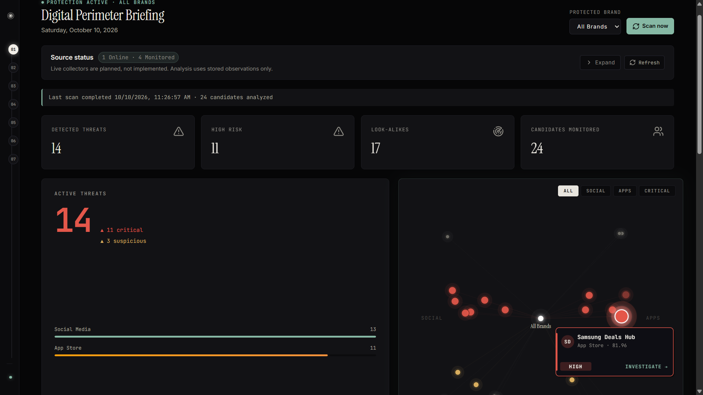
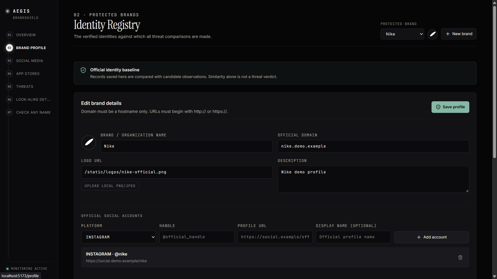
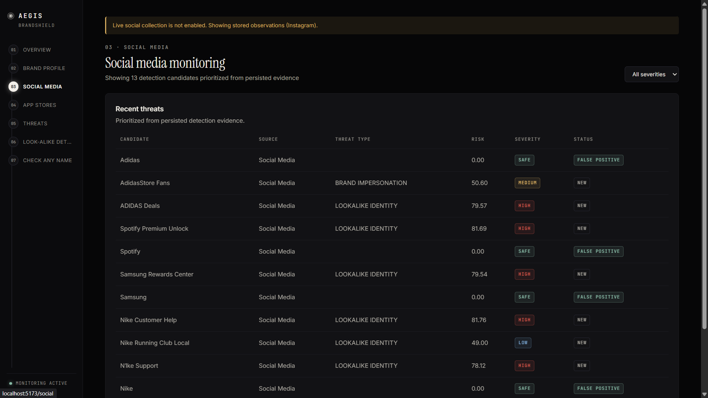
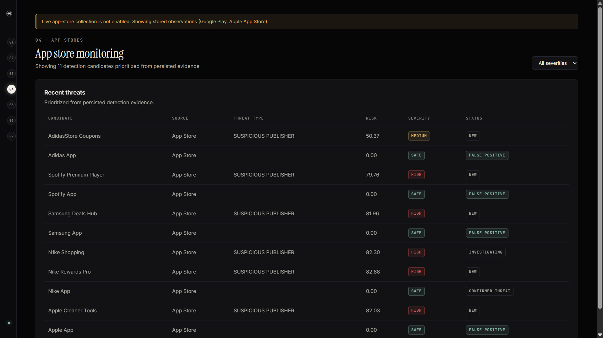
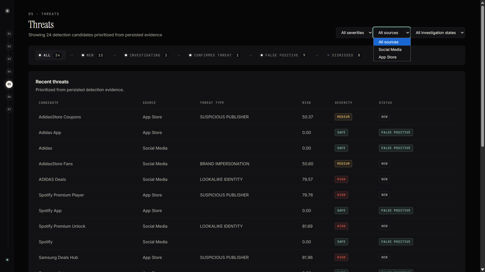
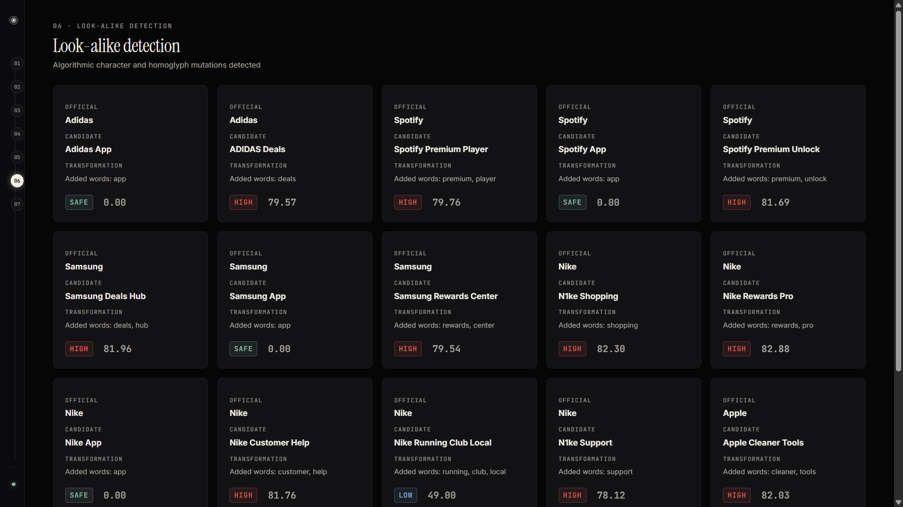
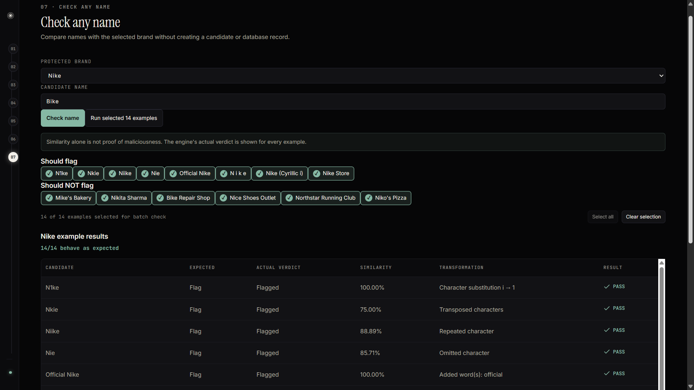
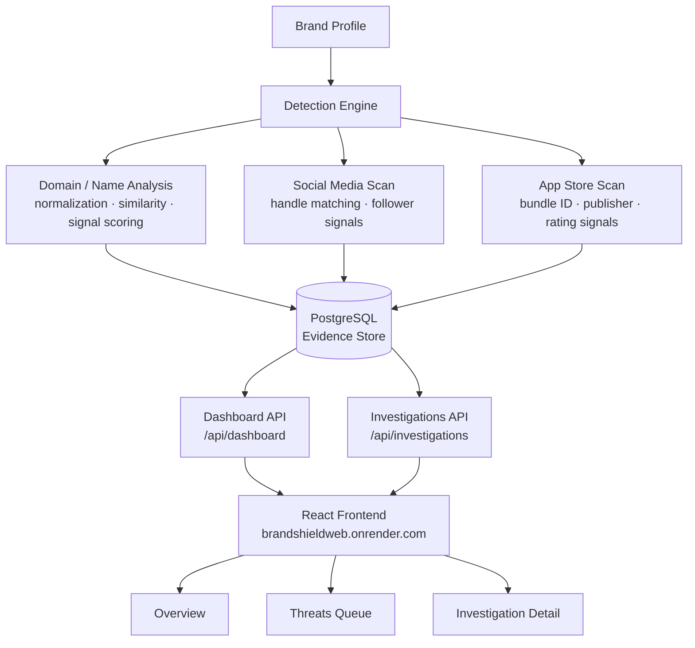
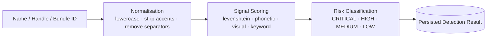

# BrandShield

**Digital Risk Protection — detect brand impersonation, fake apps, and look-alike social accounts before they cause damage.**

A full-stack DRP platform built for the Kampus.VC hackathon. BrandShield maps a brand's digital perimeter, runs deterministic detection across domains, social handles, and app store listings, and surfaces an analyst-ready investigation workflow — all backed by a persistent PostgreSQL evidence store.

> Live demo → **[https://brandshieldweb.onrender.com](https://brandshieldweb.onrender.com)**  
> API docs → **[https://brandshield-api.onrender.com/docs](https://brandshield-api.onrender.com/docs)**

---

## Screenshots

> Run the app locally and capture these pages, then save the images into `docs/screenshots/` using the exact filenames below — they will render automatically once added.

| Page | Screenshot |
|---|---|
| Overview — threat summary dashboard |  |
| Brand Profile — edit and logo upload |  |
| Social Media — impersonation scan |  |
| App Stores — fake app detections |  |
| Threats — investigation queue |  |
| Look-alike Detector — perimeter visualisation |  |
| Check Any Name — on-demand name analysis |  |

---

## Architecture

Two layers: a FastAPI backend that owns detection logic and the evidence store, and a React frontend that renders exactly what the API returns.



Detection is deterministic and offline — no live scraping, no external crawlers. All results come from the stored evidence seeded on startup.

> **"Live collectors are planned, not implemented. Analysis uses stored observations only."**



---

## Features

**Overview Dashboard** — brand-level threat summary: total detections by severity, monitoring status, and a live-updating metrics bar.

**Brand Profile** — edit brand name, industry, keywords, official handles, and upload a reference logo. Profile edits trigger a re-scan.

**Social Media Detections** — ranked list of look-alike handles across platforms with signal breakdown (name similarity, follower ratio, post patterns).

**App Store Detections** — suspicious app listings matched against the brand's known bundle IDs, publisher names, and keyword set.

**Threats Queue** — analyst-facing investigation workflow: triage, status transitions (open → investigating → resolved / dismissed), and AI-drafted remediation notes.

**Look-alike Detector** — perimeter visualisation showing the brand's official digital footprint alongside flagged candidates, with distance scores rendered as a proximity map.

**Check Any Name** — on-demand analysis: type any domain, handle, or app name and get an instant similarity report against the active brand.

**Auto-seed on Startup** — the backend seeds five demo brands (Nike, Apple, Samsung, Spotify, Adidas) with pre-computed detections on every cold start. Idempotent — safe to restart.

> **"Similarity alone is not proof of maliciousness."** Every detection score is a signal, not a verdict. Investigation and human judgement close the loop.

---

## Tech Stack

| Layer | Technology |
|---|---|
| Language | Python 3.13 |
| API | FastAPI + Uvicorn |
| ORM | SQLAlchemy 2.0 |
| Migrations | Alembic |
| DB driver | psycopg3 (psycopg[binary]) |
| Config | pydantic-settings |
| Image processing | Pillow |
| HTTP client | httpx |
| Database | PostgreSQL (Docker Compose locally, Supabase in prod) |
| Frontend | React + TypeScript |
| Build tool | Vite |
| Charts | Recharts |
| Icons | Lucide React |
| Styling | Tailwind CSS |
| Fonts | Inter · Instrument Serif · JetBrains Mono |
| Optional AI analyst | Groq-compatible OpenAI-style API (graceful fallback when no key) |
| Hosting | Render (Web Service + Static Site) |
| Node | 24 LTS |

---

## Project Structure

```
.
├── backend/
│   ├── pyproject.toml
│   ├── alembic.ini
│   ├── alembic/
│   │   └── versions/              # 5 migrations: domain tables → investigations
│   └── app/
│       ├── main.py                # FastAPI app + lifespan auto-seed
│       ├── models.py              # SQLAlchemy models
│       ├── schemas.py             # Pydantic request/response schemas
│       ├── seed.py                # Idempotent demo-data seeder
│       ├── sources.py             # Source-status router
│       ├── analyst.py             # LLM-backed remediation draft (optional)
│       ├── logos.py               # Logo upload + static serving
│       ├── api/
│       │   ├── brands.py          # Brand CRUD + re-scan trigger
│       │   ├── dashboard.py       # Aggregated metrics endpoint
│       │   ├── detections.py      # Detection read + filter endpoints
│       │   ├── health.py          # GET /api/health
│       │   ├── investigations.py  # Investigation workflow endpoints
│       │   ├── monitoring.py      # Monitoring run endpoints
│       │   └── sources.py         # Source status re-export
│       ├── core/
│       │   └── config.py          # Pydantic settings (DATABASE_URL, CORS_ORIGINS, …)
│       ├── database/
│       │   ├── base.py            # Declarative base
│       │   └── session.py         # Engine + SessionLocal + get_db
│       ├── detection/
│       │   ├── engine.py          # Orchestrates a full brand scan
│       │   ├── normalization.py   # Text normalisation helpers
│       │   └── signals.py         # Similarity signal scorers
│       └── tests/                 # pytest suite (health, detection, investigations, …)
├── frontend/
│   ├── index.html
│   ├── vite.config.ts
│   └── src/
│       ├── main.tsx               # App root + router
│       ├── api.ts                 # Typed fetch wrappers for every endpoint
│       ├── AppSidebar.tsx         # Seven-section nav (01–07)
│       ├── BrandLogo.tsx          # Logo display + upload
│       ├── BrandProfileEditor.tsx # Inline profile editing
│       ├── CheckName.tsx          # On-demand name analysis UI
│       ├── PerimeterVisualization.tsx  # Look-alike proximity map
│       └── SourceStatus.tsx       # Collector status panel
├── docs/
│   └── screenshots/               # ← paste your screenshots here (see table above)
├── data/                          # Logo storage (gitkeep)
├── docker-compose.yml             # Local Postgres + backend
├── .env.example
└── scripts/                       # QA and browser-automation helpers
```

---

## Getting Started

**Prerequisites:** Docker Desktop, Python 3.13+, Node 18+.

```bash
# 1. Clone
git clone https://github.com/Ram0kr0singh/BrandShieldWEB.git
cd BrandShieldWEB

# 2. Start PostgreSQL
docker compose up -d db

# 3. Backend
cd backend
pip install -e ".[dev]"
cp ../.env.example ../.env
# edit .env — at minimum set DATABASE_URL (see table below)
alembic upgrade head
uvicorn app.main:app --reload
# → http://localhost:8000/docs

# 4. Frontend (new terminal)
cd frontend
npm install
npm run dev
# → http://localhost:5173
```

**Environment variables (`.env` at repo root):**

| Variable | Required | Description |
|---|---|---|
| `DATABASE_URL` | Yes | PostgreSQL connection string |
| `CORS_ORIGINS` | No | Comma-separated allowed origins (default: `http://localhost:5173`) |
| `LLM_API_KEY` | No | Groq / OpenAI key for AI-drafted remediation notes — app works without it |
| `LLM_MODEL` | No | Model identifier (default: `openai/gpt-oss-120b`) |
| `LLM_BASE_URL` | No | Custom OpenAI-compatible endpoint (default: Groq) |
| `LLM_TIMEOUT_SECONDS` | No | LLM call timeout (default: `20.0`) |

The backend seeds five demo brands automatically on first startup — no manual data import needed.

---

## API Reference

| Method | Path | Description |
|---|---|---|
| `GET` | `/api/health` | Health check |
| `GET` | `/api/brands` | List all monitored brands |
| `POST` | `/api/brands` | Create a brand |
| `GET` | `/api/brands/{id}` | Get brand detail |
| `PATCH` | `/api/brands/{id}` | Update brand profile |
| `GET` | `/api/detections` | List detections (filterable by brand, severity, type) |
| `GET` | `/api/dashboard` | Aggregated threat metrics per brand |
| `GET` | `/api/investigations` | List investigations |
| `POST` | `/api/investigations` | Open a new investigation |
| `PATCH` | `/api/investigations/{id}` | Update status / add notes |
| `GET` | `/api/monitoring` | List monitoring runs |
| `POST` | `/api/monitoring` | Trigger a monitoring run |
| `GET` | `/api/sources` | Source collector status |

Full request/response schemas at `/docs` (Swagger UI) once the app is running.

**Example — GET /api/dashboard (Nike):**
```json
{
  "brand_id": 1,
  "brand_name": "Nike",
  "total_detections": 5,
  "by_severity": { "CRITICAL": 1, "HIGH": 2, "MEDIUM": 2, "LOW": 0 },
  "monitoring_active": true
}
```

---

## Deployment (Render + Supabase)

The live demo runs on Render free tier with a Supabase PostgreSQL database.

| Service | Platform | URL |
|---|---|---|
| Backend (Web Service) | Render | `https://brandshield-api.onrender.com` |
| Frontend (Static Site) | Render | `https://brandshieldweb.onrender.com` |
| Database | Supabase | Session pooler (IPv4, port 5432) |

**Key deployment settings:**

| Setting | Value |
|---|---|
| Root Directory (backend) | `backend` |
| Build Command (backend) | `pip install -e .` |
| Start Command (backend) | `alembic upgrade head && uvicorn app.main:app --host 0.0.0.0 --port $PORT` |
| Python Version | `3.13.1` |
| Root Directory (frontend) | `frontend` |
| Build Command (frontend) | `npm install && npm run build` |
| Publish Directory | `dist` |
| Rewrite Rule | `/* → /index.html` (required for SPA routing) |

**Backend environment variables on Render:**

| Key | Value |
|---|---|
| `DATABASE_URL` | Supabase Session Pooler URL (not Direct — Render free tier is IPv4 only) |
| `CORS_ORIGINS` | `http://localhost:5173,https://brandshieldweb.onrender.com` |
| `PYTHON_VERSION` | `3.13.1` |

> **Note:** Use the Supabase **Session Pooler** connection string (port 5432, hostname `*.pooler.supabase.com`), not the Direct connection. The Direct connection uses IPv6 which is unreachable from Render's free tier.

---

## Testing

```bash
cd backend
# Fast unit tests
python -m pytest -m "not integration"

# Full suite
python -m pytest
```

Tests cover: health endpoint, brand CRUD, detection engine (name normalisation, similarity signals, risk classification), domain checks, logo similarity, investigation workflow, and monitoring dashboard aggregation.

---

## Security Notes

- API keys (`LLM_API_KEY`) are read from environment variables only — never logged, stored in the database, or committed to the repo.
- Detection risk scores are computed server-side and returned as-is to the frontend. The frontend never recomputes risk, severity, threat type, or counts.
- The optional LLM analyst generates draft remediation text only — it cannot trigger any action or modify stored detections.

> **"Similarity alone is not proof of maliciousness."**

---

## Limitations

- Detection is offline and deterministic — there is no live crawling of social media, app stores, or domain registries.
- Logo similarity uses perceptual hashing (pHash) against the uploaded reference logo only; no web image fetching.
- The AI analyst (remediation drafts) is an optional feature gated behind `LLM_API_KEY`; all core DRP functionality works without it.
- Evaluated on seeded synthetic data only; no real-world brand abuse dataset was used for the hackathon submission.

> **"Live collectors are planned, not implemented. Analysis uses stored observations only."**

---

## Acknowledgments

- Hackathon: [Kampus.VC](https://kampus.vc) Digital Risk Protection challenge.
- MCA (AI & DS), K.R. Mangalam University, School of Engineering & Technology.
